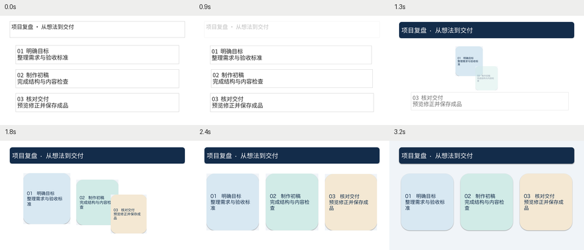

# PPT 组件重组视频

让能读图、操作文件和运行命令的 Agent，只凭本工具与原始 PPT，制作“普通排版 → 成品重组”的竖屏对比视频。无需读取以前的聊天，也无需指定模型或 API Key。

**Agent 从 [AGENT_START.md](AGENT_START.md) 开始。** 用户可把 [交给Agent的任务.txt](交给Agent的任务.txt) 连同 PPT 发给 Agent。



[查看示例视频](examples/agent-video/reference.mp4)

## 流程

导入课件 → 看全册与选页 → 确认组件、编排普通版 → 查看两版和运动预览 → 导出 → 检查成片。Agent 负责读图与判断，确定性渲染器负责画面和编码；方案可以反复修改。

- 可编辑 PPT 读取对象建议；图片型 PPT/PDF 由 Agent 看图定义组件区域。
- 文字转场避免两版重影，运动保持组件比例；支持同步、错峰、轻抬三种动效。
- 1–6 页，每页 4 秒；1080×1440、24 fps，MP4 + 普通版 PPTX + 两版图片 + 可编辑方案 + ZIP。
- 用户素材在本地处理。每次导出独立保存，全片解码与文件哈希校验。

## 运行

需要 Python 3.11+、LibreOffice 和 FFmpeg。FFmpeg 也可由依赖 imageio-ffmpeg 提供。不需要 Node.js、浏览器、OpenCV 或图文笔记引擎。

```sh
python3 -m venv .venv
.venv/bin/python -m pip install --timeout 120 -r requirements-agent.txt
.venv/bin/python agent_video.py doctor
.venv/bin/python agent_video.py prepare --ppt /path/to/source.pptx --work /path/to/new-work
```

随后根据 AGENT_START.md 编辑方案并执行 preview、render、verify。Windows 使用 `.venv\Scripts\python.exe`；环境安装步骤见入口文档。

## 实际边界

组件画面来自矩形裁剪，并非自动透明抠图。普通版是重排演示，不是原作者的历史初稿。数字、文字、裁剪边界和最终动画必须由执行 Agent 核对。系统不能保证任意截图都能恢复完整可编辑对象。

这是独立视频制作模块；可供 Agent 使用，也可接入图形界面。Windows 代码路径保留，尚未实机验证。

## 测试

```sh
.venv/bin/python -m unittest discover -s tests -v
```

第三方资源说明见 [THIRD_PARTY_NOTICES.md](THIRD_PARTY_NOTICES.md)。
