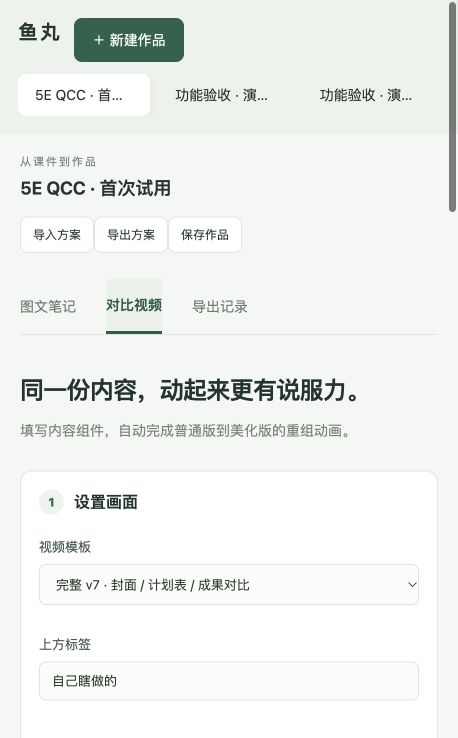
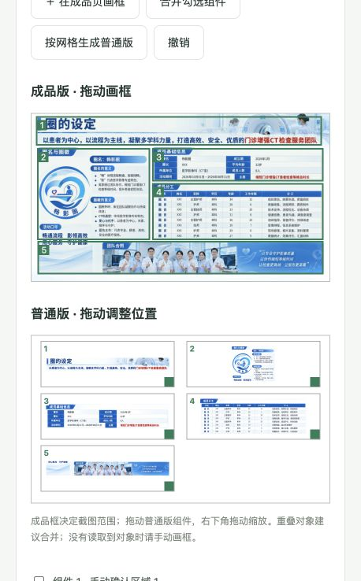
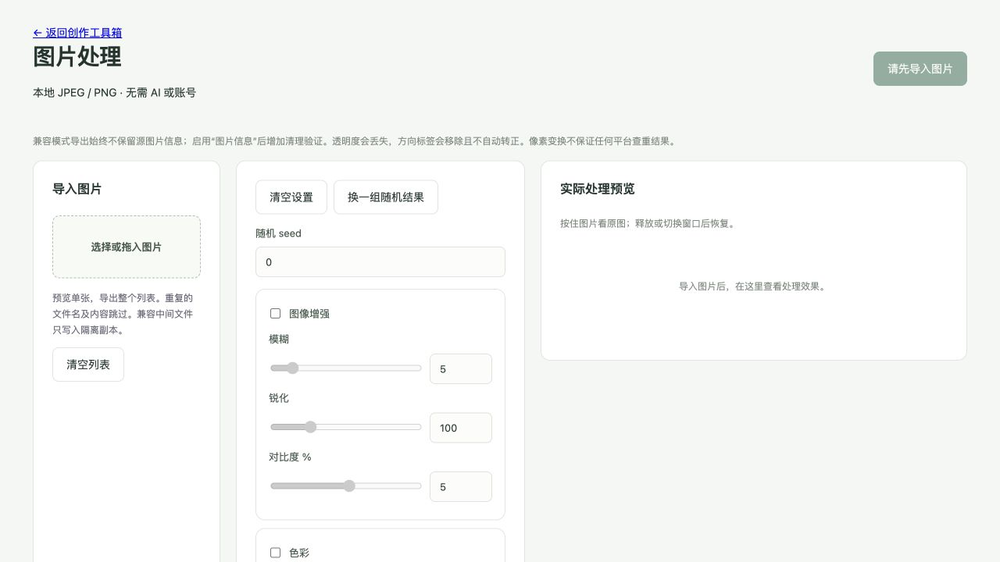

# 鱼丸创作工具箱：从下载到第一份作品

适合第一次使用、不懂代码的朋友。你只需要会下载文件、选择图片、填写文字和拖动鼠标。先完成下面的“第一条视频”，熟悉后再换成自己的素材。

本教程对应仓库当前版本。Mac 已有实际运行验证；Windows 提供启动入口，尚未完成真机验收。第一次安装需要联网，之后素材处理在本机进行。工具箱本身不要求登录，也不要求购买 AI 服务。

## 先选你要做的事

| 我想做什么 | 从哪里开始 |
| --- | --- |
| 下载、安装、打开工具箱 | 第 1、2 节 |
| 用自己的 PPT 做“普通排版 → 成品排版”视频 | 第 3 节 |
| 把课件做成一组图文笔记 | 第 4 节 |
| 修改笔记图片上的标题、位置和字号 | 第 5 节 |
| 批量处理图片、清除图片信息 | 第 6 节 |
| 做文字卡片动画或固定三段模板视频 | 第 7 节 |
| 保存、找回作品，换电脑继续做 | 第 8 节 |
| 让 Agent 帮我制作视频 | 第 9 节 |
| 安装或制作时遇到问题 | 第 10 节 |

## 1. 下载：先拿到完整文件夹

1. 打开 [工具箱 GitHub 首页](https://github.com/wei04459-blip/ppt-component-video)。仓库英文名仍是 `ppt-component-video`，里面已经是完整工具箱。
2. 点击页面上的 **Code**，再点击 **Download ZIP**。也可以[直接下载完整 ZIP](https://github.com/wei04459-blip/ppt-component-video/archive/refs/heads/main.zip)。
3. 下载完成后解压。Windows 右键压缩包，选择“全部解压”；Mac 双击压缩包。
4. 打开解压后的 `ppt-component-video-main` 文件夹。应该能看到“启动Mac.command”“启动Windows.cmd”、`web`、`engine` 等文件。
5. 把**整个文件夹**放到准备长期使用的位置，例如“文稿/文档”文件夹。不要只拿走其中的启动文件，也不要在压缩包预览窗口里直接运行。

**做到这一步的标志：**你看到的是一个普通文件夹，里面有两个系统的启动入口。

## 2. 安装并打开：只做自己电脑对应的部分

### Mac

首次使用需要三个辅助软件。它们负责处理文件，不要求你学习编程。

| 软件 | 用处 | 下载与选择 |
| --- | --- | --- |
| Python 3.11 或以上 | 运行图片和课件处理 | [Python 官方下载](https://www.python.org/downloads/)，选择有 macOS 安装包的稳定版，安装 `.pkg`；已有符合要求的版本可跳过 |
| Node.js | 运行文字卡片和固定模板视频 | [Node.js 官方下载](https://nodejs.org/en/download)，选择 LTS，下载 macOS Installer |
| LibreOffice | 把 PPT 转成工具能读取的页面 | [LibreOffice 官方下载](https://www.libreoffice.org/download/)，选择自己的 Mac 版本，安装到“应用程序” |

Mac 芯片类型可在左上角苹果菜单 →“关于本机”查看：Apple M 系列选 Apple Silicon／ARM64；Intel 选 Intel／x86_64。已有软件能正常使用时，无需重复安装。工具箱实际验证环境使用 Python 3.11；不同新版本的首次安装可能有差异。

安装后：

1. 打开工具箱文件夹，双击 **启动Mac.command**。
2. 会出现一个文字窗口，自动下载所需组件。首次启动请保持网络畅通，先不要关窗口。
3. 完成后浏览器会打开“鱼丸创作工具箱”。如果浏览器没弹出，且窗口没有报错，可手动访问 [本机工具箱](http://127.0.0.1:8766)。

如果系统说无法确认开发者，确认文件来自上面的仓库后，尝试右键启动文件 →“打开”；按系统提示处理。不要关闭系统整体安全保护。如果提示没有执行权限，看第 10 节。

### Windows

1. 打开已经解压的工具箱文件夹，双击 **启动Windows.cmd**。
2. 首次启动会检查并尝试安装 Python、Node.js 和视频所需组件。出现对应软件的安装确认时，按提示完成。
3. 要导入 PPT，再双击 **安装PPT支持Windows.cmd**，安装 LibreOffice。已经安装可以跳过。
4. 安装完成后重新双击 **启动Windows.cmd**。成功后浏览器会打开工具箱。

如果提示找不到 `winget`，到 Microsoft Store 安装或更新“应用安装程序”，或者用上表中的官方网站手动安装 Python、Node.js、LibreOffice。安装 Python 时如有 **Add python.exe to PATH** 选项，请勾选。安装后关闭旧启动窗口，重新运行启动入口。

Windows 的启动脚本尚未完成真机验收；如果失败，保留窗口最后一段错误信息，按第 10 节处理。

### 怎样判断真的打开了？

页面左侧有“＋ 新建作品”，上方有“图文笔记”“对比视频”“导出记录”，旁边有“图片处理”。地址通常是 `127.0.0.1:8766`，意思是“你这台电脑”，不是需要注册的在线网站。



*截图用于辨认区域；具体按钮文字以本文和当前页面为准。*

安装结束后，后续通常只需双击同一个启动入口。关闭浏览器不会自动关闭后台；电脑重启后，需要再次启动工具箱。

## 3. 第一条视频：先用随包素材练习

**这次的目标：**选 1 页，拆成几个内容块，做出一条 4 秒视频。上半部分固定显示普通排版，下半部分的内容块移动回原 PPT 的位置。

先认识三个词：

- **成品版**：你导入的原 PPT 页面，是动画最后要回到的样子。
- **普通版**：把同样的内容换一种简单排法，用来展示对比。
- **组件**：一起移动的一块内容，例如标题、整张表格、一组图片。它不是一种需要安装的东西。

### 第一步：新建并导入

1. 点击左侧 **＋ 新建作品**，把顶部作品名改成“我的第一条视频”。
2. 点击 **对比视频**。
3. 在“导入视频课件”中点击 **选择新的 PPT、PDF 或图片**。
4. 打开工具箱里的 `examples → agent-video`，选择 **示例课件.pptx**。
5. 等待页图出现。点击页图放大，确认内容没有乱码或缺失。

如果还没装 LibreOffice，就先导入同一文件夹里的 **示例图片页.png**，一样可以练习画框和制作视频。

### 第二步：选择页面

1. “视频模板”选择 **我的 PPT · 手动组件重组（无需 AI）**。
2. 点击 **读取当前课件**。
3. 首次练习只勾选第 1 页，然后点击这一页的 **编辑 … 个组件**。

每条最多选 6 页，每页固定 4 秒。选 2 页就是约 8 秒。导入多页不代表必须全部做进视频。

### 第三步：把页面分成几块

能直接编辑文字和图形的 PPT，可能自动读到组件建议。整页截图型 PPT 或图片可能读不到，需要自己画框。

1. 点击 **＋ 在成品页画框**。
2. 在“成品版”图片上按住鼠标，从一块内容的左上角拖到右下角，松开。
3. 每画一个框，都需要再次点击画框按钮。先试着分成“标题”“内容一”“内容二”“内容三”等 3–5 块；以你看到的页面为准。
4. 框错了，在下方对应组件旁点击 **删除**，再画一次；也可以点 **撤销**。
5. 几个框本来就属于同一组时，勾选它们，点击 **合并勾选组件**。

整张表格、完整流程图尽量各算一块，不要把每个数字拆开。框内会包含原来的背景；它不是自动抠图。首次练习不要只框整页，否则看不出内容重组。

### 第四步：做一个普通排版

1. 点击 **按网格生成普通版**，工具会把组件先排整齐。
2. 在“普通版”区域拖动组件，调整顺序和位置；拖右下角改变大小。
3. 下方的“普通版文字”可以留空：这时使用原图块，最容易保留原内容。
4. 想把某块变成黑字白底时，才填入这块的原文。核对数字、单位和标题，不要为了做对比删除关键内容。



*上方是原页的框选范围，下方是可拖动的普通版。示例截图里的医学内容不是本次练习素材。*

### 第五步：看预览，再确认

1. “重组动效”先保留 **依次移动 · 错峰入场**。
2. 点击 **查看两版实际预览**。
3. 检查普通版、成品版以及下面的运动过程：标题是否完整、内容有没有遗漏、文字是否放得下、框有没有截断图表。
4. 回到对应页，勾选 **已核对本页组件、文字和两版布局**。多页视频需要逐页勾选。

之后又改了文字或位置，就重新看预览并确认。不要只检查编辑区的小缩略图。

### 第六步：导出并播放

1. 点击 **制作并预览视频**，等待任务完成。
2. 在右侧播放生成的视频，从头看完一次。
3. 点击 **下载 MP4**，保存最终视频。
4. 点击 **下载素材包**，保留配套图片、方案等文件；也可以单独点 **下载普通排版 PPT**。
5. 点击顶部 **保存作品**。

**完成标志：**电脑上有一个能播放的 `.mp4`；画面上半部分固定，下半部分的多个内容块移动归位。仅看到预览图片，不算已经下载视频。

练习完成后，新建作品再导入自己的 PPT，重复这六步。第一次制作建议挑 1–2 页内容清楚、块状分明的页面。

## 4. 第一套图文笔记：先自动填页，再调整

准备一份自己的 PPT、PDF 或多张课件图片。随包示例页数少，更适合练视频；要做完整笔记，建议使用页数更充足的课件。

1. 点击 **＋ 新建作品**，命名，例如“课件展示练习”。
2. 在 **图文笔记 → 导入课件** 中选择文件。单次尽量控制在 100 MB 内。
3. 等待页图出现，逐张确认页码与内容。
4. 在“视觉模板”选择喜欢的版式，先看提示中的“封面几页、每张内容图几页”。
5. 点击 **按顺序填入页面**。工具先帮你填好页号，再手动调整。
6. 填写文案，点击 **生成笔记预览**。
7. 检查每张图片，点击 **下载素材包**，解压后查看图片和文案。

### 页号究竟怎么填？

页号是导入后显示的第几页，从 1 开始。**一行代表一张输出图片**，行里的多个页号代表拼到这一张图里的课件页。

例如，只有当所选模板提示“每张内容图 2 页”时，下面才表示两张内容图：

```text
2,3
4,5
```

第一张放第 2、3 页，第二张放第 4、5 页。不同模板容量不同，不能把这个例子原样套给所有模板。封面页号同样按模板容量填写；带固定页的模板保留固定页规则。页数不足时，减少内容图或换模板，不要填写不存在的页号。

### 四种文案不要混淆

| 页面上的字段 | 填什么 | 示例，仅用于理解 |
| --- | --- | --- |
| 笔记标题 | 发布到平台时用的标题，最多 20 字 | 工作汇报怎么讲清楚？ |
| 图内短句 | 真正画在图片上的短标题，尽量短 | 汇报重点一眼看懂 |
| 副标题 | 课件确实包含的补充说明 | 背景·过程·结果 |
| 话题标签 | 与素材有关的话题，用空格分隔 | #工作汇报 #PPT排版 |

出现“已确认的奖项名称”时，只填写真实、已确认的奖项；没有奖项就换普通模板。完整笔记通常建议封面加至少四张内容图、8–10 个相关话题；练习时先把少量图片做对。

笔记导出已自动清除图片元信息，也就是图片附带的作者、拍摄信息等。这个步骤保留画面像素和透明度，**不用再去图片处理页操作一遍**。“轻微调整对比度并重新编码”是另一项可选效果，首次使用保持未勾选即可。

生成只是保存到本地，不会自动发布到小红书等平台。下载后仍需你自己核对并发布。

## 5. 图片做好后，改标题、位置和大小

1. 在新生成的笔记预览中，点击要修改的图片，进入 **图内编辑**。
2. 点击一段可编辑文字，拖动它来调整位置。
3. 双击文字，或点击 **改文字**，输入新内容。
4. 用 **字号** 输入框调大小，也可以拖文字框右下角。
5. 改错时点 **撤销**；想回到打开时的样子，点 **还原这张图**。
6. 点击 **保存为新版本**，等待完成，再下载这次的新素材包。

这里能改的是工具生成的标题等文字层。课件截图里的字是一张图片的一部分，不能直接双击修改；需要先改原 PPT 再导入。旧版本或外部图片如果没有文字层，先重新生成笔记。

保存新版本后，旧版本仍保留。要确认下载的是最新一版，而不是浏览器之前已经下载的同名文件。

## 6. 图片处理：先试一张，再批量导出

入口是顶部 **图片处理**。这里接收 JPG／JPEG／PNG，和图文笔记作品是两个独立区域。

### 只想清除图片附带信息

1. 点击 **选择或拖入图片**，先导入一张普通、不透明的照片或截图。
2. 点击 **清空设置**，关闭其他效果。
3. 勾选 **图片信息**，启用清理验证。其他效果先不要勾选。
4. 看右侧预览，按住图片可对照原图，松开恢复处理后的图片。
5. 点击右上角 **导出全部 … 张**。
6. 完成后点击 **下载图片与处理报告**，解压检查。

注意：独立图片处理页会重新编码图片，并且不保留透明度；方向标签也会移除，不自动把照片转正。它与笔记导出中的“保留像素及透明度的自动清理”不同。透明贴纸、Logo 或必须保持原像素的图片，不要用这个页面当作无损清信息工具。照片方向不对时，先调整方向再导出。

### 想加一点图片变化

可以逐项尝试“图像增强”“色彩”“边框”“噪点”“旋转”“翻转”“放大”。每次只开一项、少量调整，等待预览更新，再决定是否保留。

“随机 seed”可以理解为这一组随机效果的编号，第一次保持 `0` 即可。点 **换一组随机结果** 会换编号；想保留当前效果就不要反复点。

图片变化、重新编码和元信息清理都不能保证任何平台“查重通过”。查看预览后再决定是否使用。



### 多张图片和预设

- 导入多张图片后，左侧点哪张就预览哪张；**导出会处理列表里的全部图片**，不只是当前预览。
- 一张确认合适后，再把剩余图片加入列表。
- 经常使用同一组参数：在“预设名称”输入名字，点 **新建**；之后可在下拉框切换。
- **清空设置**关闭效果，不清空图片列表，也不把所有参数数值归零。移除图片使用 **清空列表**。
- 预设只保存参数，不保存图片。刷新图片处理页后，通常需要重新导入图片；离开前先下载结果。
- 导出中可以点 **取消任务**，已经完成的结果仍可能保留。

## 7. 另外两种视频：按内容选择

| 模式 | 适合谁 | 怎么操作 |
| --- | --- | --- |
| 我的 PPT · 手动组件重组 | 已有排好的 PPT，想展示排版对比 | 按第 3 节画框、排普通版、预览、确认 |
| 轻量版 · 文字卡片重组 | 只有文字，想先做简单动画 | 填标题和说明，每段填 2–6 个文字组件，选重组方式，再制作 |
| 完整 v7 · 封面／计划表／成果对比 | 内容正好适合固定三段结构 | 展开各段，替换文字、数字、图片和时间，再制作 |

### 文字卡片练习

在“对比视频”的“视频模板”选择 **轻量版 · 文字卡片重组**。保留一段，填一个页面标题，例如“把工作汇报讲清楚”，再填三个组件：

| 组件标题 | 组件内容 |
| --- | --- |
| 背景 | 交代要解决的问题 |
| 过程 | 说明具体做了什么 |
| 结果 | 展示真实的变化 |

选一个重组方式，点 **制作并预览视频**，播放后下载 MP4。内容改成自己的事实即可。每段需要 2–6 个组件，最多 6 段。

### 固定三段模板

选择 **完整 v7 · 封面／计划表／成果对比**，逐个展开“封面内容”“活动计划表”“效果与成果”，替换预填示例。展开“替换照片与成果图”后，可上传自己的图片或选择导入的课件页。

改善前、目标、改善后数值范围为 0–100；计划表起止位置范围为 0–24，终点要大于起点。数值改了，相应的文字结论也要改。示例文字和图片不会自动变成你的实际情况，导出前逐项核对。

它固定为三段、合计 10.5 秒；不是把任意 PPT 一键变成三段。结构不合适时，使用第 3 节的手动组件模式。

## 8. 保存、找回与备份

### 三个按钮分别保存什么？

| 按钮 | 用途 |
| --- | --- |
| 保存作品 | 保存当前作品设置，方便在左侧“我的作品”继续做 |
| 下载素材包／下载 MP4 | 把最终结果保存到浏览器的下载位置，供你实际使用 |
| 导出方案 | 保存可编辑设置，文件通常叫“创作方案.json”；不是成品，也不包含源 PPT |

做完一个阶段就点 **保存作品**。重新打开工具后，在左侧选择原作品继续编辑。历史导出可在 **导出记录** 找到；重新生成不会覆盖原来的版本。

浏览器下载一般在“下载”文件夹，可通过浏览器下载列表的“在文件夹中显示”找到。工具自己的项目数据默认在系统“文稿／文档”下的 **鱼丸创作工具箱** 文件夹；导出记录中也会显示实际目录。不要把数据文件夹当作安装缓存删除。

### 换电脑怎么办？

把原始 PPT、已下载的成品和 **导出方案** 的 JSON 一起备份。新电脑先安装工具箱，再新建作品、导入相同课件，最后点 **导入方案**。重新检查页号和预览。

手动组件视频方案包含当前项目的页面引用；跨电脑导入后可能提示源课件不匹配，需重新读取、检查组件。不要把“方案 JSON”当作可以自动迁移全部作品的完整备份。

## 9. 可选：把视频交给 Agent

这里的 Agent 是能读取电脑文件、执行操作并查看图片的 AI 助手。仅能文字聊天的 AI 不能直接运行这个工具包。不用 Agent 也可以完成前面的全部手动流程。

把**完整工具包文件夹**和**原始 PPT**交给 Agent，并发送下面这段话，把文件名换成自己的：

> 请用这个工具包，把“我的课件.pptx”制作成 PPT 组件重组对比视频。先完整阅读包内 AGENT_START.md，使用现有流程完成导入、选页、分组、普通版排版、实际预览、导出和校验。先选 2 页适合展示的页面，保留原文、数字和图表含义。交付 MP4、普通版 PPT、可编辑方案和素材包。不要只给我操作建议；遇到错误先按包内说明排查，不要覆盖原课件，也不要擅自上传我的素材。

Agent 完成后，你仍要播放视频、核对原课件，尤其是数字、文字和表格。完整说明在 [Agent 制作入口](../AGENT_START.md)。

## 10. 卡住时，按现象处理

| 遇到的情况 | 先这样做 |
| --- | --- |
| 解压后不知道点哪个 | Mac 点“启动Mac.command”；Windows 点“启动Windows.cmd”，不要点 app.py 或网页源码 |
| 启动窗口一直下载 | 首次安装会下载多项组件，保持联网，先看是否仍在输出进度；明确报错后保留最后一屏，修复网络再重试 |
| 浏览器打不开或“无法访问此网站” | 先运行启动入口，再访问 `http://127.0.0.1:8766`；不能只打开网址就跳过启动 |
| Windows 找不到 Python／Node／winget | 按第 2 节手动安装官方软件，关闭旧窗口后重新启动；不要只安装一个浏览器插件 |
| PPT 导不进来 | 检查 LibreOffice；先用示例 PNG 测试。若图片能导入，问题通常在 PPT 转换环节 |
| PPT 缺字、字体不对 | 先在原演示软件打开检查；可将原课件导出 PDF 或清晰 PNG 再导入，使用手动画框 |
| 提示文件过大 | 先减少一次导入的图片数量，或把 PPT 另存为较小的 PDF；保留原文件 |
| 读取后是 0 个组件 | 截图型页面很常见，点击“＋ 在成品页画框”手动分组 |
| 看不到明显重组 | 不要只使用整页一个框；分成几块有意义的内容，调整普通版位置再看运动预览 |
| 提示逐页确认 | 每个已选页都要检查预览并勾选确认；修改页面后需要重新确认 |
| 提示源课件已更换 | 当前课件与旧方案不匹配，重新读取组件、检查页面、再确认 |
| 文字放不下或标题区域太小 | 缩短展示短句、放大普通版文字框，或换版式；不要擅自删改业务数据 |
| 图片里的字点不动 | 只有工具生成的文字层能编辑；课件截图中的字要回原 PPT 改 |
| 找不到下载文件 | 打开浏览器的下载列表，点“在文件夹中显示”；或到“导出记录”重新下载 |
| 图片处理页刷新后列表没了 | 重新导入原图，选回已保存的预设；该页面不自动恢复图片列表 |
| 图片处理后透明背景没了／方向不对 | 这是当前独立图片处理模式的限制，回到原文件处理；笔记导出的自动清理可保留透明度 |

### Mac 提示“没有执行权限”

只在遇到这个明确提示时使用：

1. 打开系统的“终端”应用。
2. 输入 `chmod +x `，最后留一个空格，暂时不要回车。
3. 把工具箱中的“启动Mac.command”拖进终端窗口，系统会自动填入文件路径。
4. 按回车，再回到文件夹双击启动入口。

### 仍然失败，怎样求助最有效？

保存下面四项，交给维护者或能操作电脑的 Agent：

```text
我的电脑：Mac / Windows；系统版本：____
我做到哪一步：例如，点击“读取当前课件”后报错
报错原文或截图：____
随包示例能否成功：示例图片导入____；示例PPT导入____
```

如果是启动问题，可在“文稿／文档 → 鱼丸创作工具箱”里找 `startup.log`、`service.stdout.log`、`service.stderr.log`，提供最后一段相关错误即可。日志和截图可能含个人文件名，分享前检查。不要把密码或整份私人素材公开贴到问题区。

## 11. 做完后，检查这五件事

- [ ] 我下载了实际图片或 MP4，不只是看到了页面预览。
- [ ] 视频从头播放过，所有选中页面都出现，文字和数字与原素材一致。
- [ ] 发布标题、图片内标题、奖项和表格结论都核对过。
- [ ] 保存了作品，并保留原始课件；需要迁移时另外保存了方案。
- [ ] 清楚工具当前完成的是本地制作，平台发布还需要自己操作。

后续参考：[图片处理详细说明](图片处理.md) · [手动组件视频说明](通用PPT视频流程.md) · [素材与字体说明](../THIRD_PARTY_NOTICES.md)
